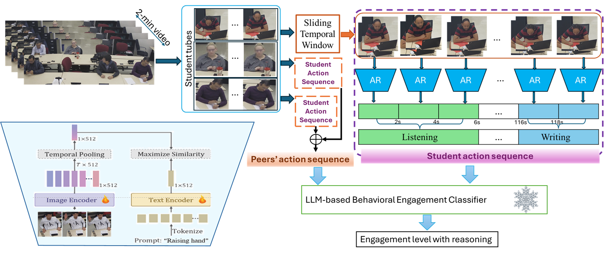

## Context-aware-Student-Engagement
This repo is the official implementation for **Context Matters: Peer-Aware Student Behavioral Engagement Measurement via VLM Action Parsing and LLM Sequence Classification**, which is accepted at **IEEE/CVF Conference on Computer Vision and Pattern Recognition Workshops (CVPRW) 2026**.
[](https://openaccess.thecvf.com/content/CVPR2026W/CV4Edu/papers/Abdelkawy_Context_Matters_Peer-Aware_Student_Behavioral_Engagement_Measurement_via_VLM_Action_CVPRW_2026_paper.pdf) <br />
 
## Abstract
Understanding student behavior in the classroom is essential to improve both pedagogical quality and student engagement.
Existing methods for predicting student engagement typically require substantial annotated data to model the diversity of student behaviors, yet privacy concerns often restrict researchers to their own proprietary datasets.
 Moreover, the classroom context, represented in peers' actions, is ignored. To address the aforementioned limitation, we propose a novel three-stage framework for video-based student engagement measurement. 
 First, we explore the few-shot adaptation of the vision-language model for student action recognition, which is fine-tuned to distinguish among action categories with a few training samples. 
 Second, to handle continuous and unpredictable student actions, we utilize the sliding temporal window technique to divide each student's 2-minute-long video into non-overlapping segments.
 Each segment is assigned an action category via the fine-tuned VLM model, generating a sequence of action predictions. Finally, we leverage the large language model to classify this entire sequence of actions, together with the classroom context, as belonging to an engaged or disengaged student. 
The experimental results demonstrate the effectiveness of the proposed approach in identifying student engagement.

# Architecture of VLM-LLM Framework
<div align=center>

</div>

# Prerequisites
- Python 3.13.13
- [PyTorch](http://pytorch.org/)
- The maintained runtime dependencies are listed in `requirements.txt`. From this
  directory, create an environment and install them with:
  ```shell
  python3.13 -m venv .venv
  .venv/bin/python -m pip install --upgrade pip
  .venv/bin/python -m pip install -r requirements.txt
  ```
  The Faster R-CNN detector and the bundled ViFi-CLIP pipeline do not require
  MMCV, YOLOX, BoxMOT, or Decord. The optional YOLO detector uses Ultralytics:
  ```shell
  .venv/bin/python -m pip install ultralytics
  ```
# Testing Pretrained Models
You may download the trained models reported in the paper via [GoogleDrive](https://drive.google.com/drive/folders/1yBpdM3Wt6F69HoXHpqGB-XkcItsXu6H3?usp=drive_link) and put them in folder pretrained_action_recog_models.

# Single student Demo

You can use the following command to test on a single student video clip. 
```shell
python SingleStudentDemo.py
```
# multiple students Demo
You can use the following command to test on video of multiple students, which requires detection and tracking.
```shell
python MultipleStudentsDemo.py
```
Note:  use engageConfig.py to set videos paths, etc.

On a server without a graphical display, the demos automatically disable
OpenCV windows and continue processing. You can also force headless mode:
```shell
ENGAGEMENT_HEADLESS=1 .venv/bin/python SingleStudentDemo.py
```

The single-student demo writes timestamped predictions to
`predictions_single_student.csv`. Copy those intervals into
`annotations_single_student.csv` and fill in `true_label`, then run:
```shell
.venv/bin/python evaluate_single_student.py
```
This creates `accuracy_matrix_single_student.csv` with the confusion matrix,
accuracy, per-class precision, recall, and F1 scores.

The multi-student demo follows the same process, but includes `student_id` in
each prediction. Run it with:
```shell
ENGAGEMENT_HEADLESS=1 .venv/bin/python MultipleStudentsDemo.py
```
Predictions are saved to `predictions_multi_student.csv`. Fill
`annotations_multi_student.csv` with one ground-truth row for each tracked
student and interval:
```csv
student_id,start_time,end_time,true_label
1,0.0,3.0,Listening
2,0.0,3.0,Writing with pen/stylus
```
Use the tracker IDs and timestamps from the prediction CSV, then run:
```shell
.venv/bin/python evaluate_multi_student.py
```
The result is written to `accuracy_matrix_multi_student.csv`.

## Batch classification by action folders

To classify every supported video under a dataset root, run:
```shell
.venv/bin/python batch_classify_dataset.py \
  --dataset "/scratch/rpp/NAS/btp_charan/EduAction-A-college-student-action-dataset-for-classroom-attention-estimation-main" \
  --output-dir batch_predictions
```
The script loads ViFiCLIP once, recursively processes each video, and writes
one CSV per source folder, for example:
```text
batch_predictions/drinking_predictions.csv
batch_predictions/lecture_predictions.csv
batch_predictions/play_phone_predictions.csv
```
Each CSV contains one row per video. `source_folder` is preserved as the
dataset label and `predicted_label` uses the project's labels from
`action_labels.csv`; no accuracy is claimed until those label vocabularies are
mapped.
# Citation
Please cite this work if you find it useful:
```BibTex
@InProceedings{Abdelkawy_2026_CVPR,
    author    = {Abdelkawy, Ahmed and Elsayed, Ahmed and Ali, Asem and Farag, Aly and Tretter, Thomas and McIntyre, Michael},
    title     = {Context Matters: Peer-Aware Student Behavioral Engagement Measurement via VLM Action Parsing and LLM Sequence Classification},
    booktitle = {Proceedings of the IEEE/CVF Conference on Computer Vision and Pattern Recognition (CVPR) Workshops},
    month     = {June},
    year      = {2026},
    pages     = {10779-10788}
}
 
